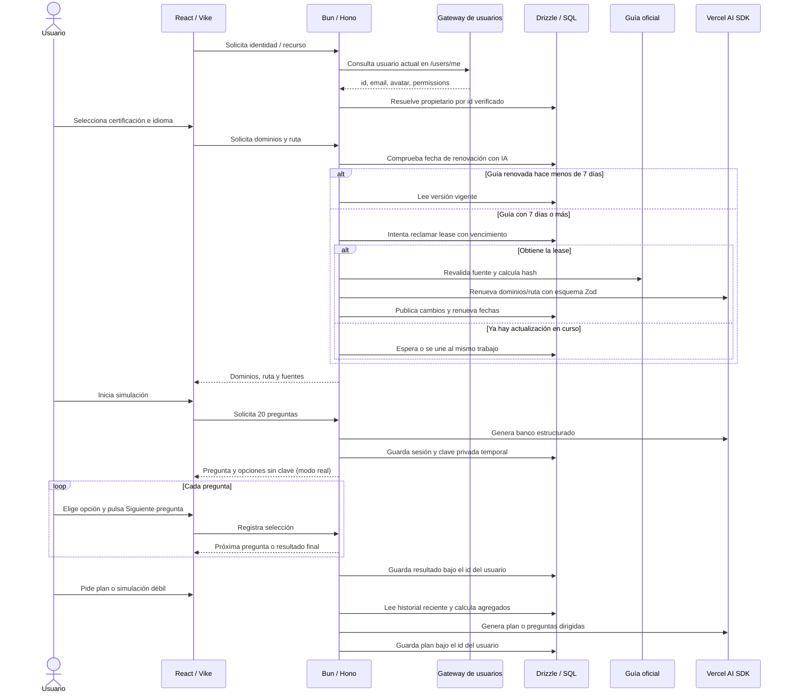

# Implementation Plan: Cert Helper — producto final

**Estado:** En implementación; PR-01 listo para revisión, PR-02…PR-07 pendientes
**Última actualización:** 2026-09-30

## Materiales fuente

- [PROJECT_PROPOSAL.md](PROJECT_PROPOSAL.md) — define el PoC de Professional Cloud Developer y sus límites actuales.
- [README.md](README.md) y [pages/index/+Page.tsx](pages/index/+Page.tsx) — describen el flujo implementado, incluidos los modos de práctica y Simulación Real.
- [Guía oficial de Professional Cloud Developer](https://cloud.google.com/learn/certification/guides/cloud-developer) — fuente para dominios, pesos y temas de GCP.
- [Página oficial de Professional Cloud Developer](https://cloud.google.com/learn/certification/cloud-developer) — referencia para la ruta de aprendizaje de Google Cloud.
- [Guía oficial AWS Solutions Architect Associate SAA-C03](https://docs.aws.amazon.com/pdfs/aws-certification/latest/solutions-architect-associate-03/solutions-architect-associate-03.pdf) — candidato de referencia; el nivel de la certificación AWS está pendiente de confirmación.
- [AI SDK: generación de datos estructurados](https://ai-sdk.dev/docs/ai-sdk-core/generating-structured-data) — referencia para generar objetos validados con Zod usando el Vercel AI SDK.

## Estado

- **Completado:** PoC local aprobado con 20 preguntas GCP, UI bilingüe pendiente, modo de práctica, Simulación Real y análisis final por dominio. Los datos aún se sirven desde JSON y no se conserva el historial de resultados.
- **Completado en PR-01:** base Bun/Hono integrada con Vike, contratos Zod, esquema Drizzle/SQLite, migración inicial, resolución de usuario con `/users/me` y pruebas de identidad/rutas/migración.
- **Pendiente:** catálogo de certificaciones dinámico, IA, UI bilingüe, sesiones seguras y persistencia del historial/planes en la aplicación.
- **Repositorio:** conectado a `https://github.com/ohurtado-wm/cert-prep.git`; PR-01…PR-07 son límites de revisión propuestos.

## Estado de PR

| PR | Alcance | Estado | Dependencia | Validación de salida |
|---|---|---|---|---|
| `PR-01` | API Hono, autenticación Gateway, contratos y persistencia Drizzle | Listo para revisión | — | API arranca, migra SQLite y valida identidad |
| `PR-02` | Catálogo y descubrimiento de guías oficiales | No iniciado | `PR-01` | Dominios y ruta con fuentes verificables |
| `PR-03` | Interfaz y contenido en español/inglés | No iniciado | `PR-02` | Flujo completo del catálogo en ambos idiomas |
| `PR-04` | Generación de preguntas y sesiones seguras | No iniciado | `PR-01`, `PR-02` | 20 preguntas válidas; sesiones privadas por usuario |
| `PR-05` | Sesiones web e historial por usuario en backend | No iniciado | `PR-01`, `PR-03`, `PR-04` | Práctica y Simulación Real guardan resultados autenticados |
| `PR-06` | Plan de estudio personalizado con IA | No iniciado | `PR-05` | Recomendaciones ligadas a resultados y fuentes |
| `PR-07` | Simulación enfocada en temas débiles | No iniciado | `PR-05` | Solo incluye temas aún no superados |

## Objetivo

Convertir el PoC en un simulador bilingüe que obtiene dominios y rutas de estudio de fuentes oficiales, genera bancos de 20 preguntas con IA, guarda en el backend el historial reciente de cada usuario por dominio y tema, y usa ese historial para proponer qué estudiar y generar simulaciones dirigidas a las áreas débiles.

## Contrato de aceptación final

El producto se considera completo solo cuando:

- `FAC-01`: al elegir una certificación disponible, se muestran dominios y ruta de aprendizaje renovados con IA desde una fuente oficial comprobada durante los últimos 7 días y presentados en español o inglés.
- `FAC-02`: al iniciar una sesión, se generan exactamente 20 preguntas originales, con cuatro opciones y una sola correcta; su tema, servicio, idioma y dominio validan contra contratos Zod y la guía seleccionada.
- `FAC-03`: la práctica guiada conserva retroalimentación y reintentos. En Simulación Real, **Siguiente pregunta** registra la selección y avanza en un clic; la API no revela la respuesta correcta hasta calcular el resultado final.
- `FAC-04`: cada sesión completada se guarda en el backend asociada al `id` verificado por el gateway; el historial sobrevive cambios de dispositivo usando la misma identidad y se puede borrar.
- `FAC-05`: el plan de estudio y la simulación enfocada usan únicamente estadísticas del historial reciente de ese usuario, explican la prioridad con esos datos y usan recursos oficiales.
- `FAC-06`: credenciales de IA y claves de respuesta del modo real no se exponen al cliente; la identidad la resuelve el gateway mediante `/users/me`; fallas o salidas inválidas de la IA terminan en un mensaje recuperable, no en una sesión incompleta.
- `FAC-07`: UI, metadatos, preguntas, explicaciones, planes y estados de error funcionan tanto en español como en inglés.

## Alcance y límites

- **Incluye:** autenticación mediante el gateway de usuarios; selección de certificación; descubrimiento de dominios/ruta; generación de preguntas; modos de práctica y real; análisis por dominio/tema; idiomas ES/EN; historial y planes asociados al usuario; sugerencias de estudio; simulación de temas débiles.
- **Certificaciones iniciales:** Professional Cloud Developer; agregar una certificación AWS después de fijar su código y nivel de examen. El catálogo debe admitir nuevas certificaciones con fuentes oficiales registradas.
- **Identidad y datos de usuario:** consumir el usuario que devuelve automáticamente el gateway mediante `/users/me` y usar su `id` como clave externa estable. Guardar resultados y planes en backend bajo ese propietario para permitir continuidad entre dispositivos; no crear contraseñas ni una identidad paralela ni gestionar credenciales del gateway en la aplicación.
- **Historial propuesto:** conservar las últimas 20 sesiones completadas por usuario y usar las 10 más recientes para recomendaciones. Guardar identificadores estables de dominio/tema, métricas y temas fallidos, no preguntas completas ni respuestas del usuario. Ofrecer una acción para borrar el historial.
- **Frescura de guías:** `lastSourceCheckedAt` registra la última comprobación exitosa de la fuente y `lastAiRefreshedAt` la última renovación exitosa con IA. Al cumplirse 7 días desde la renovación con IA, la selección de cualquier usuario puede disparar una actualización bajo demanda. Se vuelve a llamar a IA aunque el contenido oficial no haya cambiado, para cumplir la renovación semanal. Una lease SQL adquirida atómicamente permite un solo actualizador por certificación; las solicitudes concurrentes esperan o se unen al mismo trabajo. La lease tiene vencimiento para recuperarse si el proceso se interrumpe. El catálogo persistido se comparte entre usuarios, así que no se genera una guía por selección.
- **Umbral inicial propuesto:** considerar un tema débil cuando el acierto reciente quede por debajo de 80%; este umbral es configurable y no representa el puntaje de aprobación oficial.
- **Stack:** React + TypeScript estricto + Vike sobre Vite; Tailwind CSS, Zod, `fetch` nativo y TanStack Query; Bun + Hono para la API; Drizzle con SQLite para desarrollo local/una instancia, y PostgreSQL si el despliegue requiere varias instancias; Vercel AI SDK (`ai`) para las llamadas al modelo.
- **Seguridad y privacidad:** la API deriva el propietario desde una identidad validada con el gateway y aplica aislamiento por usuario en cada lectura/escritura; nunca confía en un `userId` enviado por el cliente. Usar `id` como clave, no el correo. Persistir solo ese ID externo por defecto; obtener correo/avatar del gateway si la UI los necesita y no guardar permisos ni enviarlos a IA. La IA recibe agregados mínimos calculados en servidor, sin identificadores ni datos personales.
- **Datos del navegador:** `localStorage` conserva preferencias como idioma/tema; TanStack Query mantiene caché de UI en memoria y se limpia al cerrar sesión o cambiar de identidad. El backend es la fuente de verdad para historial y planes.
- **Fuera del alcance:** contraseñas/cuentas propias, panel editorial, predicción de aprobación, reutilización de preguntas oficiales o garantía de que el contenido generativo equivalga al examen real.
- **Despliegue:** una sola versión coherente del producto. El destino de producción aún no está definido.

## Forma de implementación

- **Descubrimiento de certificación:** el catálogo contiene fuentes oficiales permitidas. Al seleccionar una certificación, la API devuelve la guía cacheada si la renovación con IA ocurrió hace menos de 7 días. Al cumplirse 7 días, esa petición intenta adquirir atómicamente una lease con vencimiento y dispara el actualizador; si ya existe una lease vigente, las solicitudes esperan o se unen al mismo trabajo. El actualizador consulta la fuente oficial con validadores HTTP cuando existan, calcula un hash del contenido normalizado y vuelve a procesar la guía con Vercel AI SDK incluso si el hash no cambió. Valida la salida estructurada y publica una nueva versión solo si dominios/ruta resultantes cambiaron; en todos los casos de éxito actualiza `lastSourceCheckedAt` y `lastAiRefreshedAt`. El vencimiento permite recuperar una actualización interrumpida. En caso de error, conserva la última versión buena, la marca como desactualizada y no la presenta como vigente ni permite generar preguntas con ella.
- **Generación:** la API compone preguntas según dominios y pesos de la certificación, pide salida estructurada con Zod, valida cantidad/opciones/respuesta única/cobertura y aplica un reintento acotado si falla. Si aún no cumple, cancela la sesión y presenta error recuperable.
- **Sesión real:** la API conserva temporalmente preguntas y claves de respuesta en SQLite/PostgreSQL, asociadas al ID verificado del usuario. Solo ese usuario puede avanzar o consultar el resultado. El navegador recibe pregunta y opciones; cada clic en **Siguiente pregunta** envía la respuesta y recibe la próxima pregunta. La API devuelve puntuación y desglose únicamente al finalizar. Las sesiones incompletas expiran y se limpian.
- **Identidad y autorización:** la aplicación consulta `/users/me` y usa el usuario que el gateway devuelve automáticamente. La API toma el `id` de esa respuesta como propietario; no acepta el `id`, correo ni permisos como autoridad si vienen solo en el cuerpo del cliente. El gateway gestiona credenciales y resolución de identidad; cada consulta de historial se limita al usuario devuelto para esa solicitud.
- **Historial y personalización:** la API guarda resúmenes de sesiones completadas con `gatewayUserId` y calcula exactitud/fallos por tema al atender recomendaciones o simulaciones débiles. Solo manda los agregados necesarios a IA, sin perfil personal; los planes generados se guardan asociados al mismo usuario. La UI consume historial/planes mediante `fetch` y TanStack Query; `localStorage` queda para preferencias y caché de interfaz.

## Touchpoints del código

| Área / archivo | Cambio previsto | Validación |
|---|---|---|
| `pages/index/+Page.tsx` | Consumir catálogo, idiomas, sesiones API, historial y acciones personalizadas | E2E de todos los recorridos |
| `src/data/certification-schema.ts` | Separar contratos compartidos de banco, preguntas visibles, clave privada, historial y salidas AI | Pruebas Zod de entradas válidas e inválidas |
| `src/data/load-certification.ts` | Reemplazar lectura JSON por `fetch` de API con estados/caché TanStack Query | Prueba de integración de carga/error |
| `src/i18n/` (nuevo) | Catálogo de cadenas y preferencia ES/EN | Pruebas de claves faltantes y cambio de idioma |
| `src/data/session-history.ts` (nuevo) | Cliente API/cache para historial por usuario y limpieza explícita; `localStorage` solo para preferencias/UI | Integración de carga, aislamiento y estados de error |
| `server/` (nuevo) | Hono, capas de rutas/casos de uso/proveedores, validación Zod y errores | `bun:test` de lógica y rutas |
| `drizzle/` (nuevo) | Esquema/migraciones de usuarios externos, sesiones/resultados/planes por propietario, guías, lease y sesiones efímeras | Migraciones sobre SQLite y PostgreSQL objetivo |
| `public/data/certifications.json` | Mantenerlo solo como banco de respaldo curado durante la transición; no será la fuente dinámica final | Prueba del fallback y del límite de idioma |
| `package.json` | Scripts de API, migración, pruebas, E2E y ejecución local | Ejecutar los comandos documentados |
| `tests/` (nuevo) | Fixtures oficiales anonimizados, modelos falsos, evaluaciones y recorridos browser | CI y canary AI controlado |

## Estrategia de revisión

- `PR-01`: base de API, contratos y esquema SQL; gate antes de integrar IA. Anterior: ninguno; siguiente: `PR-02`.
- `PR-02`: guía oficial y contrato de dominios/ruta. Tras acordar el contrato, `PR-03` y `PR-04` pueden avanzar en paralelo. Anterior: `PR-01`; siguiente: `PR-03`/`PR-04`.
- `PR-03`: traducción e interfaz del catálogo. Anterior: `PR-02`; siguiente: `PR-05`.
- `PR-04`: generación y sesiones seguras. Anterior: `PR-02`; siguiente: `PR-05`.
- `PR-05`: integración de autenticación, sesiones, resultados y persistencia por usuario. Anterior: `PR-01`, `PR-03` y `PR-04`; siguiente: `PR-06`/`PR-07`.
- `PR-06` y `PR-07`: recomendaciones y simulación de temas débiles; pueden revisarse en paralelo una vez fijado el contrato de analítica por usuario en `PR-05`.
- **Secuencia crítica:** `PR-01` → `PR-02` → `PR-04` → `PR-05` → `PR-06`/`PR-07`.
- **Serialización:** contratos compartidos, migraciones y la semántica de exactitud/tema se fijan antes de que las pantallas o recomendaciones dependan de ellos.

## Paralelismo

- **Puede correr en paralelo:** UI bilingüe y generador una vez acordado el contrato de dominios/ruta; plan de estudio y simulación débil una vez entregado el contrato de historial/agregados.
- **Debe aterrizar primero:** middleware de identidad y esquema Drizzle antes de guardar sesiones por usuario; guía oficial y dominios antes de generar preguntas; contrato de historial por usuario antes de personalizar.
- **Punto de serialización:** el esquema de pregunta y el cálculo por tema/domino son contratos consumidos por el backend, la UI y ambas funciones personalizadas.

## PR-01: API, contratos y persistencia

**ID:** `PR-01`  
**Estado:** Listo para revisión
**Objetivo:** agregar base de backend con validación y persistencia sin acoplar UI al proveedor de IA.  
**Dependencia:** ninguna.

### Tareas

- [x] `P1-T01` Añadir entrada Bun + Hono y separar rutas, casos de uso y adaptadores de datos.
- [x] `P1-T02` Configurar Drizzle con SQLite local, migraciones y tipos/contratos Zod compartidos. PostgreSQL queda para cuando se defina el destino de despliegue.
- [x] `P1-T03` Definir entidades de certificación/guía, sesiones efímeras y perfil externo por `gatewayUserId` único; guardar sesiones completadas y planes vinculados al usuario.
- [x] `P1-T04` Integrar la API con `/users/me` para obtener el usuario resuelto por el gateway y derivar de su respuesta el propietario de cada operación; nunca confiar en un ID enviado por el cliente.
- [x] `P1-T05` Integrar API con Vike en desarrollo y producción bajo el mismo origen, con configuración segura de secretos por entorno.
- [x] `P1-T06` Añadir `bun:test` para dominio/rutas y prueba de migración desde base vacía.

### Criterios de validación

- [x] Bun inicia API y UI; endpoint de salud no requiere credenciales.
- [x] Migraciones y operaciones básicas pasan en SQLite; las rutas devuelven errores de identidad con contrato estable.
- [x] Rutas privadas requieren un usuario devuelto por `/users/me` y resuelven el propietario exclusivamente desde ese `id`.
- [x] Ningún secreto del proveedor queda en bundles, JSON público o logs.

## PR-02: Catálogo y guía oficial de certificación

**ID:** `PR-02`  
**Estado:** No iniciado  
**Objetivo:** convertir fuentes oficiales en dominios/ruta bilingües con procedencia verificable.  
**Dependencia:** `PR-01`.

### Tareas

- [ ] `P2-T01` Crear catálogo con ID estable, nombre, idioma, código de examen y URL oficial permitida; incluir Professional Cloud Developer y agregar AWS cuando se elija su nivel/código.
- [ ] `P2-T02` Implementar adaptadores acotados por proveedor para consultar guías oficiales, registrar URL, `lastSourceCheckedAt`, `lastAiRefreshedAt`, hash y versión; usar `ETag`/`If-Modified-Since` cuando estén disponibles.
- [ ] `P2-T03` Al seleccionar una certificación cuya última renovación con IA ocurrió hace 7 días o más, intentar reclamar lease atómica con vencimiento e iniciar el actualizador; peticiones concurrentes esperan o comparten el mismo trabajo.
- [ ] `P2-T04` En cada renovación semanal, procesar la guía con Vercel AI SDK y salida estructurada Zod aunque el hash oficial siga igual; validar y publicar cambios de dominios/ruta atómicamente, y registrar ambas fechas tras una renovación exitosa.
- [ ] `P2-T05` Si falla la fuente o IA, conservar la última versión válida pero marcarla desactualizada; informar al usuario y bloquear nuevas sesiones con esa guía hasta verificarla.
- [ ] `P2-T06` Exponer consulta de catálogo y detalle; devolver enlaces/versión de fuente para que la UI explique de dónde salen los temas.
- [ ] `P2-T07` Añadir fixtures oficiales y evaluaciones para versión fresca, contenido sin cambio, guía modificada, actualizaciones concurrentes y fallos; comprobar que contenido idéntico también se renueva con IA una vez por periodo semanal compartido.

### Criterios de validación

- [ ] Respuestas válidas siempre incluyen certificación, dominios, ruta y fuentes; respuesta inválida o fuente caída produce error recuperable.
- [ ] Una guía renovada con IA hace menos de 7 días se sirve de SQLite; a partir de los 7 días cualquier selección intenta disparar su actualización.
- [ ] Cada actualización exitosa vuelve a procesar la fuente con IA; cambios de dominios/ruta publican nueva versión y una salida equivalente solo renueva las fechas.
- [ ] Solicitudes concurrentes causan como máximo una revalidación y una llamada de IA por certificación y periodo de renovación.
- [ ] Si la renovación falla, se conserva la versión previa marcada como obsoleta, no se etiqueta como actual y se bloquea generación con ella.
- [ ] CI corre contra fixtures, no depende de una descarga pública ni de credenciales AI.

### Riesgos / preguntas

- La certificación “AWS Architect” necesita nivel/código de examen antes de registrar fuente; SAA-C03 es solo un candidato documentado, no una decisión tomada.

## PR-03: Interfaz y experiencia bilingüe

**ID:** `PR-03`  
**Estado:** No iniciado  
**Objetivo:** permitir navegar el producto completo en español o inglés y mostrar el catálogo dinámico.  
**Dependencia:** `PR-02`; puede avanzar en paralelo con `PR-04` al congelar los contratos de la API.

### Tareas

- [ ] `P3-T01` Añadir selector de idioma ES/EN y recordar la preferencia en `localStorage`, separado de la preferencia claro/oscuro.
- [ ] `P3-T02` Externalizar cadenas de UI y traducir pantallas, errores, accesibilidad, resultados y contenido de orientación.
- [ ] `P3-T03` Integrar selector de certificación con dominios/ruta y fuentes que devuelve la API; mostrar estados de carga, fallo y caché.
- [ ] `P3-T04` Mantener IDs de certificación/dominio/tema independientes del idioma para que las estadísticas combinen contenido ES/EN.
- [ ] `P3-T05` Añadir pruebas de idioma, persistencia de preferencia y revisión responsive/Accesibilidad.

### Criterios de validación

- [ ] Todas las pantallas visibles y mensajes de error se pueden recorrer en ambos idiomas.
- [ ] Cambiar idioma no mezcla métricas ni duplica dominios con IDs equivalentes.
- [ ] El modo claro/oscuro actual permanece funcional en ambos idiomas.

## PR-04: Generación de preguntas y sesión segura

**ID:** `PR-04`  
**Estado:** No iniciado  
**Objetivo:** generar bancos de sesión desde dominios oficiales y proteger la clave de Simulación Real.  
**Dependencias:** `PR-01` y `PR-02`.

### Tareas

- [ ] `P4-T01` Definir esquema de pregunta: dominio/tema estable, foco, servicio, enunciado, cuatro opciones, única correcta, explicación y fuente de respaldo.
- [ ] `P4-T02` Generar exactamente 20 preguntas en el idioma solicitado, con cobertura proporcional a los pesos de la guía, usando Vercel AI SDK y `Output.object`/Zod.
- [ ] `P4-T03` Validar cardinalidad, IDs repetidos, una respuesta correcta, coherencia del dominio y nivel de idioma; permitir reparación acotada y cancelar si sigue inválido.
- [ ] `P4-T04` Guardar temporalmente preguntas y clave en servidor, asociadas al `gatewayUserId` verificado. El endpoint real devuelve opciones sin clave; solo el propietario puede avanzar y al final recibe calificación por tema/dominio.
- [ ] `P4-T05` Mantener la ruta de práctica que entrega retroalimentación, explicación y opción para reintentar.
- [ ] `P4-T06` Limitar duración, tokens, intentos, concurrencia y frecuencia; instrumentar costo/latencia sin registrar prompts, claves ni respuestas.
- [ ] `P4-T07` Añadir prueba con proveedor falso y canary de calidad para cobertura, respuestas, duplicados y ambos idiomas.

### Criterios de validación

- [ ] No se inicia sesión si no hay exactamente 20 preguntas que pasan el esquema.
- [ ] Prueba HTTP demuestra que la respuesta inicial real y las preguntas subsecuentes no contienen clave, explicación ni indicador correcto.
- [ ] El servidor acepta solo una respuesta por pregunta y calcula resultados correctos al cerrar la sesión.
- [ ] Otro usuario autenticado no puede leer, avanzar ni finalizar una sesión ajena.
- [ ] Si el proveedor falla o excede límites, UI puede reintentar sin quedar en una sesión parcial y las claves permanecen en servidor.

## PR-05: Sesión web e historial por usuario

**ID:** `PR-05`  
**Estado:** No iniciado  
**Objetivo:** conectar la UI bilingüe al generador y conservar resultados recientes por dominio/tema.  
**Dependencias:** `PR-01`, `PR-03` y `PR-04`.

### Tareas

- [ ] `P5-T01` Consumir el perfil autenticado del gateway y usar la API para sesiones; mostrar estados de autenticación, carga, error recuperable y progreso.
- [ ] `P5-T02` En modo real, **Siguiente pregunta** envía la opción elegida y avanza en un solo clic; en la última pregunta pasa al resultado. Mantener el flujo guiado existente.
- [ ] `P5-T03` Guardar cada resumen completado en backend bajo el `gatewayUserId` verificado, con certificación/revisión, fecha, idioma, modo, nota y conteos por dominio/tema/foco.
- [ ] `P5-T04` Retener las 20 sesiones más recientes por usuario, devolverlas desde API y permitir borrar su historial y planes; conservar en `localStorage` solo preferencias.
- [ ] `P5-T05` Mostrar historial reciente; no persistir preguntas, respuestas ni claves en el historial, y limpiar el caché de consultas al cerrar sesión o cambiar de usuario.
- [ ] `P5-T06` Añadir pruebas de cálculo/retención, solicitudes sin identidad, aislamiento entre dos usuarios y E2E práctica vs real, incluyendo recarga y persistencia.

### Criterios de validación

- [ ] Práctica permite volver a intentar/revelar; modo real bloquea por avance, no filtra la clave y califica al finalizar.
- [ ] Historial sobrevive a recarga y cambio de dispositivo; contiene los agregados necesarios y solo lo puede consultar su propietario autenticado.
- [ ] Sin historial, UI comunica que se necesita completar una simulación; un fallo del backend muestra error recuperable sin mezclar datos locales de otro usuario.

## PR-06: Plan de estudio sugerido

**ID:** `PR-06`  
**Estado:** No iniciado  
**Objetivo:** recomendar qué estudiar a partir de los resultados recientes, sin delegar la aritmética al modelo.  
**Dependencia:** `PR-05`; puede avanzar en paralelo con `PR-07` una vez compartido el módulo de analítica.

### Tareas

- [ ] `P6-T01` Añadir botón **Sugerir plan de estudio** y estados para historial ausente, carga y error.
- [ ] `P6-T02` Leer del backend las últimas 10 sesiones del usuario autenticado, calcular agregados por IDs de tema/dominio y enviar a IA únicamente conteos/tasas y focos fallidos.
- [ ] `P6-T03` Generar con IA un plan estructurado por prioridad, motivo medible y pasos/recurso oficial; redactar en idioma elegido.
- [ ] `P6-T04` Guardar cada plan bajo el `gatewayUserId`, mostrar los resultados que sustentan sus prioridades y permitir regenerarlo.
- [ ] `P6-T05` Probar cálculos con datos fijos y forma/idioma/sources de salida con proveedor falso más canary acotado.

### Criterios de validación

- [ ] Prioridades coinciden con estadísticas determinísticas del historial; la IA redacta y recomienda, no cambia el puntaje.
- [ ] Plan en español e inglés contiene recursos oficiales y no inventa métricas ni marca “aprobado”.
- [ ] Request a IA no incluye preguntas, opciones, identificador/correo/avatar ni historial completo.

## PR-07: Simulación de temas débiles

**ID:** `PR-07`  
**Estado:** No iniciado  
**Objetivo:** generar una simulación nueva que practique únicamente temas no superados recientemente.  
**Dependencia:** `PR-05`; reutiliza el generador de `PR-04`.

### Tareas

- [ ] `P7-T01` Derivar temas débiles desde las 10 sesiones más recientes con exactitud y cantidad de errores por tema/foco.
- [ ] `P7-T02` Ordenar áreas por más errores, menor exactitud y recencia; aplicar el umbral acordado para excluir temas superados.
- [ ] `P7-T03` Añadir botón **Practicar temas débiles**, mostrar antes de iniciar qué temas se incluirán y pedir 20 preguntas solo de ellos.
- [ ] `P7-T04` Si no hay historial o áreas débiles, explicar el estado y ofrecer práctica normal sin mezclar temas superados silenciosamente.
- [ ] `P7-T05` Guardar el resultado como sesión normal y validar elegibilidad/exclusión con casos límite.

### Criterios de validación

- [ ] Ninguna pregunta generada pertenece a un dominio/tema que el análisis marcó superado.
- [ ] Si las áreas débiles no cubren 20 preguntas, el generador distribuye las 20 únicamente entre ellas.
- [ ] Historial vacío, todos los temas superados y resultados muy recientes/incompletos producen estados claros.

## Validación transversal

- [ ] Pruebas `bun:test` para esquemas, identidad/aislamiento, puntuación, prioridad de recomendaciones, retención por usuario y lógica de exclusión.
- [ ] Pruebas de integración Hono + Drizzle contra SQLite temporal; validar el dialecto PostgreSQL antes del despliegue que lo requiera.
- [ ] E2E en ES/EN de selección → ruta → generación → práctica y modo real → resultado → historial → plan/temas débiles.
- [ ] Canaries AI pequeños, versionados y con presupuesto limitado; CI usa proveedor falso y fixtures oficiales congelados.
- [ ] Ejecutar `typecheck`, build Vike, migraciones y E2E desde comandos documentados.
- [ ] Inspeccionar respuestas de red del modo real y bundles cliente para comprobar que no publican claves ni secretos.
- [ ] Verificar sesión ausente/expirada, aislamiento entre usuarios, borrado propio y que la IA no reciba identificadores del gateway.
- [ ] Verificar errores de fuente/proveedor, timeout, salida inválida, límite de uso y fallos de almacenamiento/red.
- [ ] Probar el TTL de 7 días, leases y actualización concurrente sobre SQLite; validar el mismo contrato en PostgreSQL antes de multi-instancia.

## Preguntas abiertas

- ¿Cuál certificación AWS debe incluirse: Solutions Architect Associate SAA-C03, Professional SAP-C02 u otra? El código de examen es necesario para fijar guía y dominios.
- ¿Qué proveedor/modelo aprobado usará Vercel AI SDK y cuál es el presupuesto/latencia máxima por selección, simulación y recomendación?
- Confirmar los valores propuestos de historial: 20 sesiones guardadas, 10 para análisis y 80% como umbral de tema superado.
- ¿El destino inicial será local/una instancia (SQLite) o habrá despliegue multi-instancia (PostgreSQL)? Esto determina la base de producción y expiración de sesiones.
