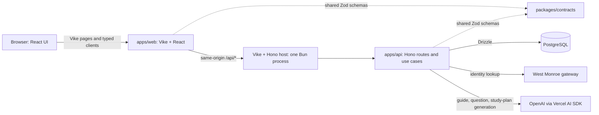

# Arquitectura

## Vista de componentes

## Workspaces

- `apps/web/` owns Vike routing (`pages/`), React components, styling, i18n, browser data loaders and HTTP clients. Its `+server.ts` composes Vike and Hono in the existing Bun process.
- `apps/api/` owns the Hono app, routes, use cases, catalog, simulations, study plans, gateway provider, AI integrations, configuration, PostgreSQL repositories/schema and migrations.
- `packages/contracts/` owns Zod request/response schemas and TypeScript types used by browser and server. It contains no database or runtime business logic.
- `tests/` remains at the root for cross-workspace unit and PostgreSQL integration coverage.

## Request and data flow

1. The browser loads Vike pages and calls typed helpers in `apps/web/src/api/`.
2. Requests to `/api/*` enter the Hono host created by `apps/web/+server.ts`; Hono forwards them to the API app from `apps/api`.
3. Route handlers resolve the current user and call use-case services. Zod contracts validate inputs and outputs at the HTTP boundary.
4. Services use repositories/Drizzle for PostgreSQL or AI generators for guide, question and study-plan work.
5. The same-origin response returns to the browser. Real-mode answer keys remain server-side until completion.

## Persistence and operations

- PostgreSQL is the runtime database. The API owns `apps/api/drizzle/postgresql/`; the older SQLite history remains under `apps/api/drizzle/` for reference only.
- `compose.yaml` runs PostgreSQL, a one-shot migrator and one web/API app container. The app waits for successful migration before starting.
- Root `package.json` coordinates Bun workspaces and provides common development, build, typecheck, test and database commands. `bun.lock` remains the single lockfile.
- `Dockerfile`, Compose files and `.env.example` remain at the repository root.

## Security boundaries

- Production identity comes from the West Monroe gateway; only its stable ID is used as the database owner key.
- AI keys, prompts, generated private content and answer keys are not logged or exposed as public client data.
- Public response schemas live in `packages/contracts`; internal persistence state remains within `apps/api`.
